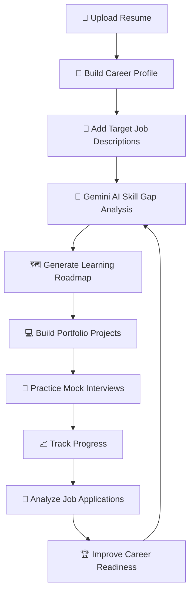

# 🚀 PivotPilot — Your AI-Powered Career Pivot Coach

<div align="center">

### 🎯 Don't just plan your career transition. Navigate it intelligently.

**Discover your skill gaps. Build your roadmap. Develop your portfolio. Prepare for opportunities.**

An AI-powered career development platform that transforms career aspirations into structured, actionable learning journeys using Google Gemini.

<br/>


<br/>

**⭐ Explore • 📈 Learn • 💡 Build • 🎤 Practice • 🏆 Grow**

</div>

---

## 🌟 What is PivotPilot?

Changing careers or preparing for a new professional opportunity can be overwhelming. Knowing what to learn, which skills to improve, what projects to build, and how to prepare for interviews requires a structured approach.

**PivotPilot brings these pieces together in one intelligent career development workspace.**

Powered by Google Gemini, PivotPilot analyzes your career profile and target job descriptions to generate personalized insights, adaptive learning roadmaps, portfolio recommendations, and interview preparation experiences.

Instead of following generic learning plans, build a journey around your own goals, existing capabilities, and available time.

## ✨ Key Features

### 📊 1. Personalized Career Dashboard
- Monitor your career readiness score.
- Track learning progress and achievements.
- View important career development metrics.
- Access your career journey from one dashboard.

### 📄 2. AI Resume Analysis
- Upload your resume for AI-powered parsing.
- Extract professional experience, education, skills, and achievements.
- Build a structured career profile.
- Identify relevant experience and transferable skills.

### 🎯 3. Intelligent Skill Gap Analysis
- Compare your existing skills against target job descriptions.
- Identify critical missing competencies.
- Evaluate skill importance and proficiency levels.
- Discover transferable skills from existing experience.
- Understand your readiness for different job opportunities.

### 🗺️ 4. Adaptive Learning Roadmaps
- Generate personalized weekly learning plans.
- Organize activities into courses, reading, practice, projects, and interviews.
- Set learning goals based on available weekly hours.
- Track completed tasks and milestones.
- Adapt your learning journey as your progress changes.

### 💻 5. AI-Powered Portfolio Projects
- Receive project recommendations based on identified skill gaps.
- Explore project difficulty and estimated completion hours.
- Understand project deliverables and recruiter relevance.
- Track suggested, ongoing, and completed projects.

### 🎤 6. AI Mock Interview Preparation
- Practice behavioral interviews.
- Prepare for role-specific interviews.
- Work through case-based and technical questions.
- Receive AI-generated answer evaluations.
- Identify strengths and improvement areas.
- Review improved answer examples and follow-up questions.

### 📈 7. Progress Tracking & Achievements
- Monitor learning progress.
- Maintain weekly progress records.
- Track skill confidence and readiness history.
- Record blockers and learning plan adjustments.
- Unlock achievements as you progress.

### 💼 8. Job Application Analytics
- Track job applications and their statuses.
- Analyze application outcomes across different segments.
- Monitor response rates and application performance.
- Identify patterns and areas requiring improvement.
- Generate AI-assisted application insights.

---

## 🧠 How PivotPilot Works



PivotPilot creates a continuous improvement cycle where career insights inform learning priorities and progress informs future development.

## 🛠️ Technology Stack

| Category | Technologies |
|---|---|
| Frontend | React 19, TypeScript |
| Styling | Tailwind CSS 4 |
| Backend | Node.js, Express.js |
| AI Integration | Google Gemini API |
| Build Tool | Vite |
| Data Visualization | Recharts |
| Animations | Motion |
| Icons | Lucide React |
| Development Runtime | TSX |

## 🏗️ Project Structure

```text
pivotpilot/
│
├── public/
│   └── assets/
│
├── src/
│   ├── components/
│   │   ├── Achievements
